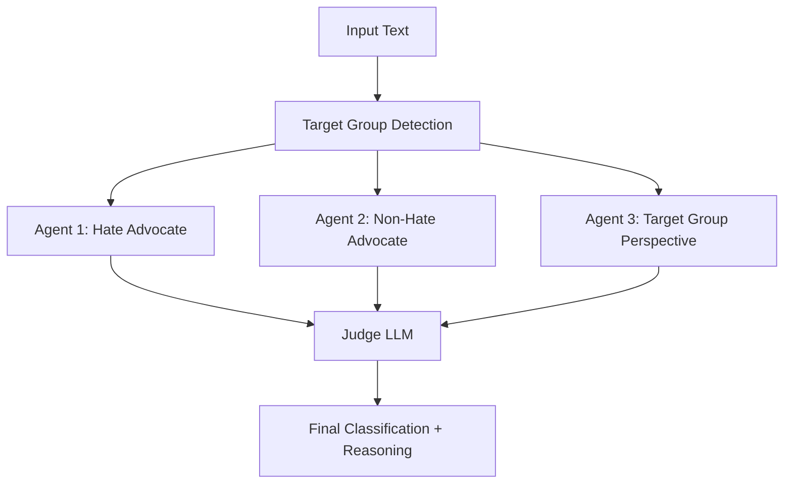
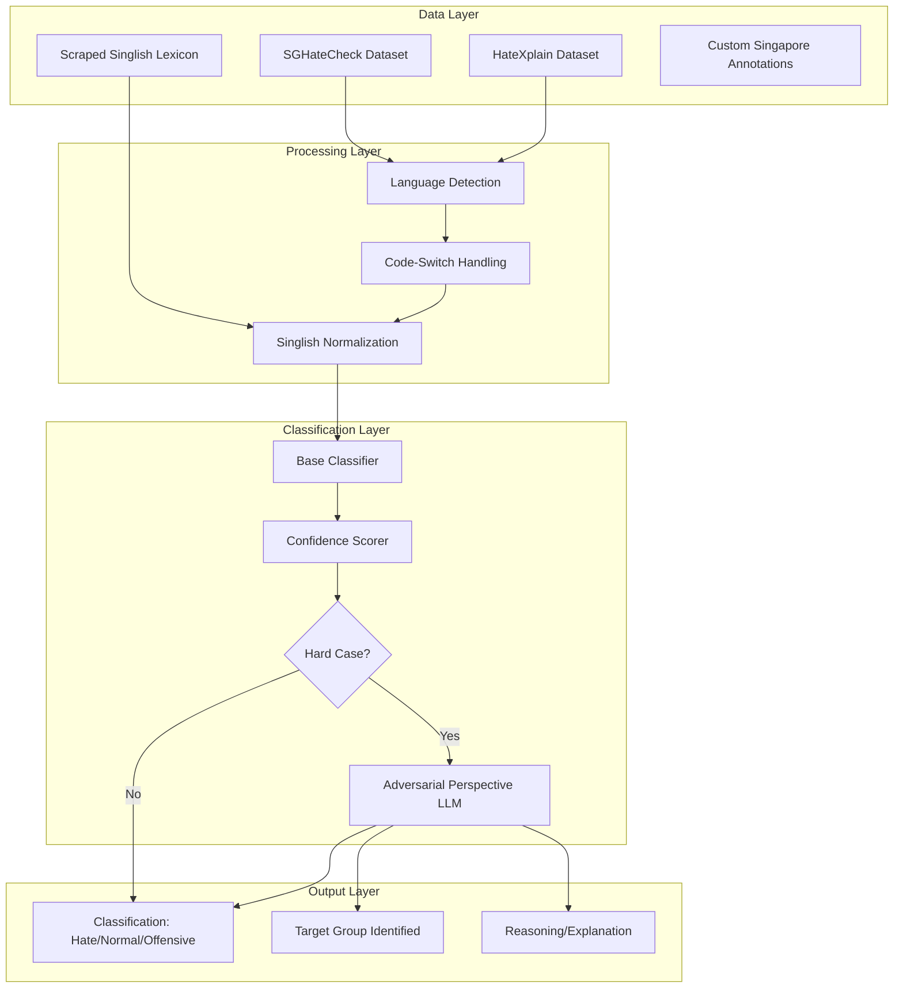

# Adversarial Hate Speech Classification for Singapore

A research plan for developing an adversarial hate speech classifier that leverages LLM-based perspective simulation and is optimized for Singapore's multilingual/multicultural context.

---

## Overview

This plan outlines the development of a **Singaporean-focused adversarial hate speech classifier** with two key innovations:

1. **Adversarial Perspective Simulation** — For hard-to-classify cases, an LLM simulates as the identified target group to evaluate whether content is genuinely hateful from the victim's perspective
2. **Singapore-Contextualized Detection** — Trained on local languages (English, Singlish, Mandarin, Malay, Tamil) and dialects (Hokkien, Teochew) with cultural context awareness

---

## Part 1: Adversarial Perspective Simulation

### Core Concept

For ambiguous or borderline cases, use an LLM to **role-play as a member of the targeted group** to evaluate:
- Would this statement cause harm/offense to the target community?
- Does the context suggest hateful intent?
- Are there cultural/linguistic nuances that change interpretation?

### Architecture Options

#### Option A: Single-Agent Perspective Taking
```
Input → Base Classifier → [Hard Case?] → Perspective LLM → Final Decision
                              ↓
                         Easy Case → Direct Classification
```

#### Option B: Multi-Agent Debate (PREDICT-style)
Reference: [PREDICT Framework Paper](https://aclanthology.org) — uses LLM agents debating from hate/non-hate stances



### Implementation Approach

| Component | Description |
|-----------|-------------|
| **Hard Case Detector** | Uses confidence scores from base classifier to route uncertain cases |
| **Target Group Identifier** | Identifies which protected group is potentially targeted (race, religion, nationality, etc.) |
| **Perspective Prompt Template** | Crafted prompts that instruct LLM to evaluate from specific group perspective |
| **Reasoning Extractor** | Captures *why* the content is/isn't hateful for explainability |

### Prompt Engineering for Perspective Simulation

```markdown
**System Prompt Example:**

You are evaluating potentially hateful content from the perspective of a [TARGET_GROUP] person in Singapore.

Consider:
1. How would this statement make you feel?
2. Does it perpetuate harmful stereotypes about your community?
3. Is there cultural context that changes the meaning?
4. Would this statement normalize discrimination?

Evaluate honestly, distinguishing between:
- Genuine hate speech that harms the community
- Criticism that may be uncomfortable but legitimate
- Inside jokes/reclaimed language used within the community
- Code-switching or cultural expressions that appear offensive out of context
```

---

## Part 2: Singapore-Focused Resources & Datasets

### Primary Datasets

#### 1. SGHateCheck (Recommended Starting Point)
| Attribute | Details |
|-----------|---------|
| **Source** | [GitHub: SGHateCheck](https://github.com/Social-AI-Studio/SGHateCheck) |
| **Languages** | Singlish (7,023 cases), Malay (5,356), Tamil (4,387), Mandarin (4,386) |
| **Total Cases** | 21,152 test cases |
| **Protected Groups** | 14 target categories across 6 protected groups |
| **Functionalities** | 30 hate speech expression patterns inherited from HateCheck |
| **Paper** | [ACL Anthology - EMNLP 2024](https://aclanthology.org/2024.findings-emnlp.142/) |

> [!IMPORTANT]
> SGHateCheck is specifically designed for Singapore's socio-linguistic context and should be the **primary evaluation benchmark**.

#### 2. HateXplain (Currently Used in Project)
- Already integrated in your notebooks
- English-only but provides rationale annotations useful for training explainable models

#### 3. Bilingual Malay-English Dataset
| Attribute | Details |
|-----------|---------|
| **Size** | 26,985 posts |
| **Source** | [Mendeley Data](https://data.mendeley.com/) |
| **Task** | Binary hate speech detection |
| **Languages** | Code-mixed Malay-English from social media |

---

### Singlish & Local Language Resources

#### Primary Resource: Chimbridge Singlish Dictionary

| Attribute | Details |
|-----------|---------|
| **Website** | [singlishdict.app](https://singlishdict.app/) |
| **Total Terms** | **4,988 words** with etymology, definitions, and usage |
| **Sources Page** | [singlishdict.app/sources](https://singlishdict.app/sources/) |
| **Creator** | kaanaas (klingonpigeon) |

> [!NOTE]
> **Citation**: When using data from Chimbridge Singlish Dictionary, cite as:
> *Chimbridge Singlish Dictionary* (2024-2026). kaanaas (klingonpigeon). https://singlishdict.app/

#### Chimbridge Dictionary Source References (Relevant for Hate Speech)

| Source | Type | Relevance |
|--------|------|-----------|
| [NUS Language and Computation Lab](https://langcomplab.github.io/singlish.html) | Academic | Singlish linguistic research |
| [NTU - Hokkien Swear Words Study](https://www.ntu.edu.sg/docs/librariesprovider120/lms/sample-students-work/lms_ssw_ay2012-samanthacatherinebokshiyun.pdf) | Academic | **Hokkien profanity evolution in SG** |
| [Taiwan MOE Hokkien Dictionary](https://sutian.moe.edu.tw) | Government | Comprehensive Hokkien reference |
| [Wikipedia: Hokkien Profanity](https://en.wikipedia.org/wiki/Hokkien_profanity) | Encyclopedia | Hokkien offensive terms |
| [Jack Lee - SMU Singlish Dictionary](http://www.mysmu.edu/faculty/jacklee/) | Academic | Academic-quality definitions |
| [EDMW Acronyms & Lingo](https://forums.hardwarezone.com.sg/threads/acronyms-and-lingo-peculiar-to-edmw.1738415/) | Forum | Internet slang/potentially offensive |
| [Talking Cock - Coxford Dictionary](https://web.archive.org/web/20111221090237/http://www.talkingcock.com/html/lexec.php?op=LexView&lexicon=lexicon) | Archived | Classic Singlish dictionary |

#### Additional Scrapeable Sources

| Resource | URL | Content | Notes |
|----------|-----|---------|-------|
| **Wikipedia Singlish Vocabulary** | [wikipedia.org/wiki/Singlish_vocabulary](https://en.wikipedia.org/wiki/Singlish_vocabulary) | Comprehensive list with etymologies | Public domain ✅ |
| **NLB NewspaperSG** | [eresources.nlb.gov.sg](https://eresources.nlb.gov.sg/newspapers) | Historical Singapore newspapers | Research access |
| **CantoDict Project** | [cantonese.sheik.co.uk](https://www.cantonese.sheik.co.uk/dictionary/) | Cantonese dictionary | Community project |
| **PRPM (Malay)** | [prpm.dbp.gov.my](https://prpm.dbp.gov.my/) | Official Malay dictionary | Government |

#### Dialect-Specific Sources

| Dialect/Language | Resources |
|------------------|-----------|
| **Hokkien** | Taiwan MOE dictionary, NTU profanity study, Wikipedia Hokkien profanity |
| **Teochew** | Grouped with Hokkien; 海口方言詞典 (1996) cited in Chimbridge |
| **Cantonese** | CantoDict, 粵典 words.hk, CC-Canto |
| **Malay** | PRPM official dictionary, NTU code-switching research |
| **Tamil** | Limited resources; Singapore Tamil differs from Indian Tamil |
| **Mandarin** | Baidu Baike, Singapore Mandarin specific terms |

---

### Scraping Strategy

#### Phase 1: Structured Data Collection

```python
# Proposed scraping targets
SCRAPING_TARGETS = {
    "chimbridge_singlish": {
        "url": "https://singlishdict.app/",
        "terms": 4988,
        "format": "structured_dictionary",
        "fields": ["term", "etymology", "definition", "usage", "language_origin"]
    },
    "wikipedia_singlish": {
        "url": "https://en.wikipedia.org/wiki/Singlish_vocabulary",
        "legal": True,
        "format": "html_table",
        "fields": ["term", "origin_language", "meaning", "usage_example"]
    },
    "wiktionary_singlish": {
        "url": "https://en.wiktionary.org/wiki/Category:Singlish",
        "legal": True,
        "format": "category_pages"
    }
}
```

#### Phase 2: Curated Lexicon Building

| Category | Examples | Hate Speech Relevance |
|----------|----------|----------------------|
| **Racial Slurs** | (culturally sensitive — to be researched carefully) | High |
| **Religious Terms** | Terms that become offensive in certain contexts | Medium-High |
| **Dialect Expressions** | Hokkien/Teochew phrases with multiple meanings | Medium |
| **Food/Cultural References** | Terms that could be used pejoratively | Low-Medium |
| **Code-Mixed Expressions** | English-Malay-Mandarin mixing patterns | Context-dependent |

---

## Part 3: Proposed System Architecture



---

## Part 4: Implementation Roadmap

### Phase 1: Data Collection (Week 1-2)
- [ ] Download and explore SGHateCheck dataset
- [ ] Scrape Chimbridge Singlish Dictionary & Wikipedia Singlish vocabulary
- [ ] Curate Hokkien/Teochew terms relevant to hate speech
- [ ] Create term→origin→sensitivity mapping

### Phase 2: Base Classifier (Week 2-3)
- [ ] Extend existing BERT classifier with multilingual support
- [ ] Fine-tune on SGHateCheck data
- [ ] Implement confidence-based hard case routing

### Phase 3: Adversarial Perspective Module (Week 3-4)
- [ ] Design perspective-taking prompts for each target group
- [ ] Implement multi-agent debate architecture (optional)
- [ ] Create reasoning extraction pipeline

### Phase 4: Evaluation & Iteration (Week 4-5)
- [ ] Evaluate on SGHateCheck benchmark
- [ ] User studies with Singaporean annotators
- [ ] Error analysis on hard cases

---

## Part 5: Technical Integration with Existing Project

### Files to Create/Modify

| File | Action | Purpose |
|------|--------|---------|
| `data/sghatecheck/` | NEW | SGHateCheck dataset storage |
| `data/singlish_lexicon.json` | NEW | Scraped Singlish vocabulary |
| `notebooks/adversarial_hate_speech.ipynb` | NEW | Main implementation notebook |
| `src/perspective_classifier.py` | NEW | Adversarial perspective module |
| `src/language_detector.py` | NEW | Singlish/Malay/Tamil detection |
| `src/scraper/singlish_scraper.py` | NEW | Wikipedia/dictionary scraper |

### Key Dependencies to Add

```toml
# pyproject.toml additions
[project.optional-dependencies]
singapore = [
    "langdetect",      # Language detection
    "googletrans",     # Translation support
    "beautifulsoup4",  # Web scraping
    "mwparserfromhell" # Wikipedia parsing
]
```

---

## Part 6: Research Questions to Explore

1. **Does perspective simulation improve accuracy on edge cases?**
   - Compare base classifier vs. adversarial approach on SGHateCheck hard cases

2. **Which target groups benefit most from perspective taking?**
   - Analyze performance by protected group category

3. **How does Singlish lexicon augmentation affect detection?**
   - Ablation study: with/without Singlish normalization

4. **Can multi-agent debate reduce false positives?**
   - Measure impact on over-classification of marginalized communities' speech

---

## Immediate Next Steps

1. **Clone SGHateCheck** from GitHub and explore the dataset structure
2. **Prototype Singlish scraper** for Chimbridge dictionary and Wikipedia vocabulary
3. **Design perspective prompts** for Singapore's 6 protected groups
4. **Create evaluation notebook** using existing DSPy infrastructure

---

## References & Citations

| Resource | Citation | Link |
|----------|----------|------|
| SGHateCheck | Gabriel et al. (2024). SGHateCheck: Functional Tests for Detecting Hate Speech in Singapore. EMNLP 2024. | [GitHub](https://github.com/Social-AI-Studio/SGHateCheck) |
| Chimbridge Singlish Dictionary | kaanaas (klingonpigeon). (2024-2026). *Chimbridge Singlish Dictionary*. | [singlishdict.app](https://singlishdict.app/) |
| PREDICT Framework | ACL Anthology | [Paper](https://aclanthology.org) |
| HateCheck | Röttger et al. (2021). HateCheck: Functional Tests for Hate Speech Detection Models. ACL 2021. | [Paper](https://aclanthology.org/2021.acl-long.4/) |
| SMU Singlish Dictionary | Lee, J. T. (2004-present). *A Dictionary of Singlish and Singapore English*. | [mysmu.edu](https://courses.mysmu.edu/faculty/jacklee/) |
| NTU Hokkien Profanity Study | Bok, S. C. (2012). *Not so "chee bai" anymore: a look at Hokkien swear words in Singapore*. NTU. | [PDF](https://www.ntu.edu.sg/docs/librariesprovider120/lms/sample-students-work/lms_ssw_ay2012-samanthacatherinebokshiyun.pdf) |
| Singapore IMDA LLM Research | IMDA National Multimodal LLM Programme | [imda.gov.sg](https://www.imda.gov.sg) |
